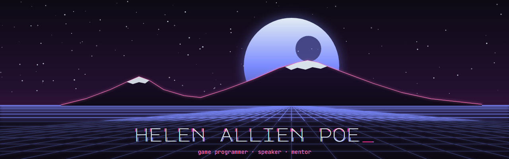

    

💚 Gamedev 💛 UI && Shaders 💜 Lua 💙

👋 Hi, I'm a game programmer from Yerevan 🇦🇲 with 15 years in gamedev: Unreal Engine 5, C++, UI and shaders, custom engines with Lua. Tech co-founder of 🔮 [The Witches Circle](https://thewitchescircle.games/).

     

### 🛠️ Now

- 🏰 **[ThroughArcaneEyes](https://github.com/besteto/ThroughArcaneEyes)** — UE5.8 vertical slice: C++ architecture, MVVM + CommonUI.
- 🕯️ **[DOPROS](https://store.steampowered.com/app/4348260/DOPROS/)** — our studio's game, Godot 4.6 + Dialogic 2. Tooling: [TWC_intro_sequence](https://github.com/besteto/TWC_intro_sequence), a data-driven intro screen sequencer.

### 🎮 My games `#MadeWithDefold`

- 🧬 **[SELF//FORK](https://besteto.itch.io/self-fork)** — copy yourself into data packets and drop them through a cyberpunk physics board. [Wishlist on Steam](https://store.steampowered.com/app/4675280/SELFFORK) ✨
- 🌳 **[Pando Garden](https://besteto.itch.io/pando-garden)** — wake a sleeping forest, one root at a time. Defold Game Jam 2026
- 🎁 **[Auris Play](https://besteto.github.io/auris-play/)** — an HTML5 birthday present

### 🎤 Talks and writing

- 🖼️ [UE5 UI: Best Practices and Optimization Tips](https://www.youtube.com/watch?v=9_sJxjLEuU0) — GCon 25
- 🎨 [Cartoonify: Techniques We Call Toon Shaders](https://www.youtube.com/watch?v=TvY7_apgH9c) — GCon 24
- 📖 Scientific editor of the Russian edition of [Game Programming Patterns](https://bombora.ru/book/59095/) (Eksmo, 2021)
- 🏆 [DevGAMM Awards](https://devgamm.com/) judge since 2018, [MyIndie](https://myindie.net/) judge and mentor

### 🤝 Work with me

💼 UE5 consulting: UI (UMG, CommonUI, MVVM) and UI performance, editor tools, C++ architecture, code review.

🌱 Also open to part-time work, tech co-founding, mentoring, jam judging and talks — [say hi on LinkedIn](https://www.linkedin.com/in/alena-ponomarenko).
